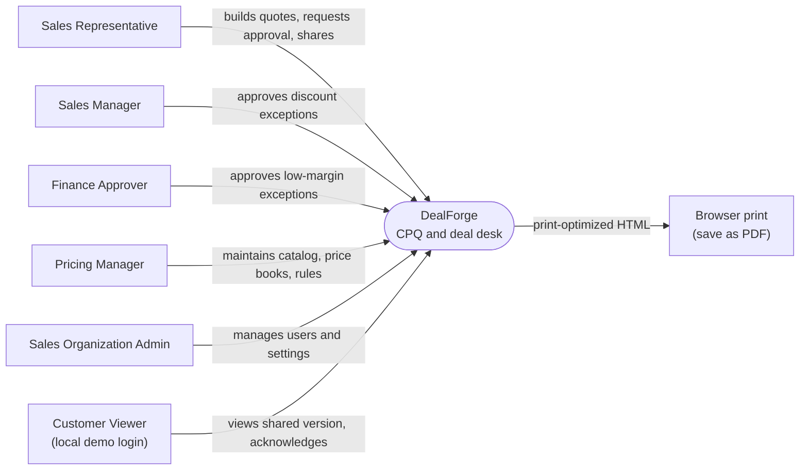
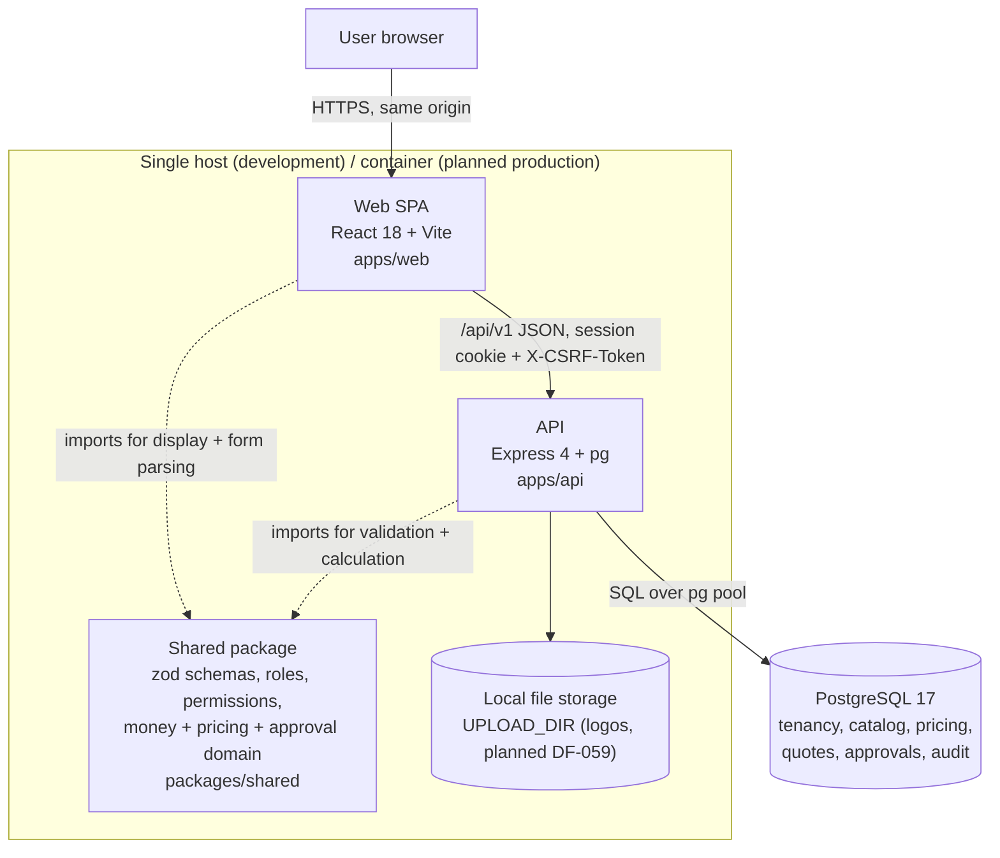
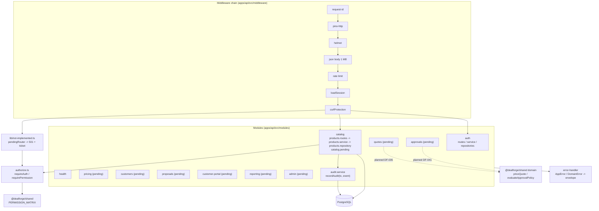

# Architecture overview

DealForge is a configure-price-quote (CPQ) and deal-desk application for B2B
suppliers. It is built as a **modular monolith** ([ADR-0002](../adr/0002-modular-monolith-with-npm-workspaces.md)):
one Express API process, one React single-page application and one shared
TypeScript package, all backed by a single PostgreSQL database.

This document describes the system at three C4 levels, the module boundaries,
the request lifecycle and the cross-cutting concerns. Each section states what
**exists now** and what is **planned** (with backlog ticket ids from
[backlog.md](../planning/backlog.md)).

## Status at a glance

| Area                                                                          | Status      | Tickets          |
| ----------------------------------------------------------------------------- | ----------- | ---------------- |
| Monorepo, `run.sh`, CI, auth, CSRF, rate limiting, audit table, health checks | Implemented | DF-001 to DF-003 |
| Role model and permission matrix                                              | Implemented | DF-004           |
| Money module, pricing engine, approval policy evaluator (pure domain)         | Implemented | DF-021 to DF-023 |
| Product catalog list/create/get API and screen                                | Implemented | DF-011, DF-012   |
| Price books, rules persistence, simulation                                    | Planned     | DF-024 to DF-029 |
| Customers, quotes, versions, calculation, lifecycle                           | Planned     | DF-030 to DF-040 |
| Approval workflow                                                             | Planned     | DF-041 to DF-044 |
| Proposal, sharing, customer portal                                            | Planned     | DF-045 to DF-048 |
| Dashboard, reports, notifications, audit timeline                             | Planned     | DF-049 to DF-054 |

## C4 level 1: system context



DealForge has **no outbound integrations** in the MVP: no CRM, payment, tax,
e-signature or email provider (PRD non-goals). All data lives in the tenant's
PostgreSQL rows; proposals are printed by the browser.

## C4 level 2: containers



| Container  | Responsibility                                                                                        | Technology                                                                                                         |
| ---------- | ----------------------------------------------------------------------------------------------------- | ------------------------------------------------------------------------------------------------------------------ |
| Web        | Screens from PRD §4, form parsing, money display. Never authoritative for totals or permissions.      | React, React Router, Vite dev proxy                                                                                |
| API        | Authentication, authorization, validation, tenancy, persistence, audit, server-side pricing.          | Express, pg, pino, helmet, zod                                                                                     |
| Shared     | Contracts used by both sides: envelope, roles, permission matrix, zod schemas, pure domain functions. | TypeScript, zod                                                                                                    |
| PostgreSQL | System of record, constraints as last line of defence.                                                | PostgreSQL 17, forward-only SQL migrations ([ADR-0004](../adr/0004-postgresql-and-forward-only-sql-migrations.md)) |

The shared domain lives in `packages/shared/src/domain/` so the web can format
and preview with exactly the same integer rules the API uses. The **API is the
only place where a persisted total is computed** (FR-07, [ADR-0013](../adr/0013-integer-money-and-rounding-policy.md)).

## C4 level 3: API components



Every module follows the same layering ([ADR-0002](../adr/0002-modular-monolith-with-npm-workspaces.md)):

- **Routes** parse input with shared zod schemas (`parseOrThrow`), apply the
  permission guard and translate results into the envelope ([ADR-0006](../adr/0006-api-conventions.md)).
- **Service** owns use cases: tenant scoping by the session organization,
  record-level rules, transactions and audit writes.
- **Repository** owns SQL. Every statement filters by `organization_id`
  ([ADR-0003](../adr/0003-multi-tenancy-row-level-organization-scoping.md)).

Pending endpoints are registered in `modules/<module>/<module>.routes.ts` as
`PendingRoute[]` with **per-route permission guards**, and mounted through a
single `pendingRouter(PENDING_ROUTES, [requireAuth])`. Unauthenticated callers
get 401, unauthorized roles get 403, permitted roles get
`501 NOT_IMPLEMENTED` with `details.ticket`. The API surface therefore already
matches the contract in [openapi.yaml](../api/openapi.yaml).

## Module boundaries

| Module          | Owns (tables)                                                                                              | Depends on                        | Status                                               |
| --------------- | ---------------------------------------------------------------------------------------------------------- | --------------------------------- | ---------------------------------------------------- |
| auth            | `users`, `sessions`                                                                                        | organizations                     | Implemented; memberships DF-008                      |
| catalog         | `products`, `option_groups`, `product_options`, `option_incompatibilities`, `bundles`, `bundle_components` | auth, audit                       | Products implemented (DF-011); rest DF-013 to DF-020 |
| pricing         | `price_books`, `price_book_lines`, `pricing_rules`                                                         | catalog, shared domain            | DF-024 to DF-029                                     |
| customers       | `customers`, `customer_contacts`                                                                           | auth                              | DF-030                                               |
| quotes          | `quote_families`, `quote_versions`, `quote_lines`                                                          | pricing, customers, shared domain | DF-032 to DF-040                                     |
| approvals       | `approval_steps`                                                                                           | quotes, shared domain             | DF-041, DF-042                                       |
| proposals       | `customer_quote_grants`                                                                                    | quotes                            | DF-045, DF-046                                       |
| customer-portal | `customer_acknowledgments`                                                                                 | proposals                         | DF-047                                               |
| reporting       | `notifications` (read side over all tables)                                                                | all                               | DF-049 to DF-054                                     |
| admin           | organization settings columns, users                                                                       | auth                              | DF-009, DF-010                                       |
| audit           | `audit_events`                                                                                             | none                              | Implemented (DF-003)                                 |

Rules: modules call each other only through service functions, never through
another module's repository; cross-module reads for reporting are SQL views or
read-only queries owned by `reporting`. Pure calculation lives in the shared
package and never touches the database or the clock.

## Request lifecycle

The sequence below is the implemented `POST /api/v1/products` path; every
state-changing endpoint follows the same shape.

```mermaid
sequenceDiagram
  autonumber
  participant B as Browser (web)
  participant V as Vite proxy
  participant M as API middleware
  participant R as products.routes
  participant S as products.service
  participant P as products.repository
  participant DB as PostgreSQL

  B->>V: POST /api/v1/products (cookie sid, X-CSRF-Token, JSON)
  V->>M: forward (same origin)
  M->>M: request id, helmet, body limit, rate limit
  M->>DB: SELECT session by sha256(token) and active user
  M->>M: Origin check + HMAC CSRF compare
  M->>R: req.auth = { user, sessionToken }
  R->>R: requirePermission('catalog:write') else 403
  R->>R: parseOrThrow(createProductSchema) else 422
  R->>S: create(actor, input, requestId)
  S->>DB: BEGIN
  S->>P: insert(actor.organizationId, ...)
  P->>DB: INSERT products
  S->>DB: INSERT audit_events (same transaction)
  S->>DB: COMMIT (or ROLLBACK; 23505 -> 409 CONFLICT)
  S-->>R: Product DTO (bigint -> safe integer)
  R-->>B: 201 { success, data, error: null }
```

Errors at any step are thrown as `AppError` or `DomainError` and rendered by
the error handler as `{ success: false, data: null, error: { code, message,
details?, requestId } }`. Unknown errors become `500 INTERNAL_ERROR` without
internals.

## Cross-cutting concerns

| Concern         | Implementation now                                                                                                                                           | Planned                                                                                                                 |
| --------------- | ------------------------------------------------------------------------------------------------------------------------------------------------------------ | ----------------------------------------------------------------------------------------------------------------------- |
| Authentication  | scrypt hashes, opaque session token (only SHA-256 stored), HTTP-only SameSite=Lax cookie ([ADR-0005](../adr/0005-session-authentication-scrypt-and-csrf.md)) | Organization selection DF-008                                                                                           |
| CSRF            | Origin/Referer check + HMAC(session) header on unsafe methods                                                                                                | none                                                                                                                    |
| Authorization   | `requirePermission` against the shared matrix ([ADR-0007](../adr/0007-role-based-access-control.md))                                                         | Record-level checks: own drafts (DF-032), no self-approval (DF-042), customer grants (DF-047)                           |
| Tenancy         | `organization_id` from the session on every query; cross-tenant ids return 404                                                                               | Same pattern for every new table                                                                                        |
| Validation      | zod at the boundary; `DomainError` -> 422; DB CHECK constraints                                                                                              | Rule schema (DF-026), configuration validator (DF-017)                                                                  |
| Money           | Integer minor units, integer bps, BigInt intermediates, half-away-from-zero rounding ([ADR-0013](../adr/0013-integer-money-and-rounding-policy.md))          | Tax estimate DF-029                                                                                                     |
| Audit           | `recordAudit(tx, ...)` in the same transaction ([ADR-0008](../adr/0008-append-only-audit-trail.md))                                                          | Timeline DF-053                                                                                                         |
| Observability   | pino JSON logs with redaction, `X-Request-Id`, `/api/health/live` and `/ready`                                                                               | Metrics and tracing per [deployment.md](../operations/deployment.md)                                                    |
| Configuration   | zod-validated env, refuses unsafe production secrets ([ADR-0009](../adr/0009-configuration-and-secrets-management.md))                                       | Secrets manager in production                                                                                           |
| Background work | Session sweep interval in the API process                                                                                                                    | Notifications and expiry worker ([ADR-0012](../adr/0012-in-app-notifications-and-background-worker.md), DF-052, DF-054) |
| Files           | `UPLOAD_DIR` reserved ([ADR-0011](../adr/0011-local-file-attachment-storage.md))                                                                             | Logo upload DF-059                                                                                                      |

## Key product decisions

- [ADR-0013](../adr/0013-integer-money-and-rounding-policy.md) Integer money and rounding policy.
- [ADR-0014](../adr/0014-effective-dated-immutable-price-book-versions.md) Effective-dated, immutable price-book versions.
- [ADR-0015](../adr/0015-pricing-rule-engine-and-stacking-policy.md) Pricing rule engine and stacking policy.
- [ADR-0016](../adr/0016-immutable-quote-revisions.md) Immutable quote revisions.
- [ADR-0017](../adr/0017-approval-policy-routing.md) Approval policy routing.
- [ADR-0018](../adr/0018-customer-portal-explicit-version-grants.md) Customer portal access through explicit version grants.

See [system-design.md](../design/system-design.md) for module-level flows and
state machines, and [data-model.md](../design/data-model.md) for the schema.
