# Data model

The complete relational model for DealForge, derived from PRD §6. Tables that
exist today come from `apps/api/migrations/0001_foundation.sql` and
`0002_roles_and_products.sql`; every other table is planned and listed with the
ticket that creates it. Migrations are forward-only
([ADR-0004](../adr/0004-postgresql-and-forward-only-sql-migrations.md)).

## Naming differences from the PRD

| PRD name                                             | Repository name                                  | Reason                                                                                                                                                                                                                            |
| ---------------------------------------------------- | ------------------------------------------------ | --------------------------------------------------------------------------------------------------------------------------------------------------------------------------------------------------------------------------------- |
| `sales_organizations`                                | `organizations`                                  | Foundation table (migration 0001). `currency_code` added in 0002; `timezone`, `margin_floor_bps`, `manager_discount_threshold_bps`, `max_manual_discount_bps`, `default_tax_bps`, `default_quote_expiry_days` arrive with DF-010. |
| `users(email_normalized, name)`                      | `users(email, display_name)`                     | `email` is stored lower-cased with a CHECK; unique globally.                                                                                                                                                                      |
| `users` + `sales_memberships(role)`                  | `users.role` (single role)                       | MVP keeps one role per user; `sales_memberships` replaces it in DF-008.                                                                                                                                                           |
| `audit_logs(subject_type, subject_id, payload_json)` | `audit_events(entity_type, entity_id, metadata)` | Foundation table; adds `request_id`.                                                                                                                                                                                              |
| `products.default_list_minor / default_cost_minor`   | `products.list_price_minor / unit_cost_minor`    | Clearer names; price-book lines hold the effective prices.                                                                                                                                                                        |

## Entity-relationship diagram

```mermaid
erDiagram
  organizations ||--o{ users : employs
  organizations ||--o{ sales_memberships : grants
  users ||--o{ sales_memberships : holds
  users ||--o{ sessions : opens
  organizations ||--o{ customers : sells_to
  customers ||--o{ customer_contacts : has
  organizations ||--o{ products : catalogs
  products ||--o{ option_groups : configures
  option_groups ||--o{ product_options : offers
  product_options ||--o{ option_incompatibilities : side_a
  product_options ||--o{ option_incompatibilities : side_b
  organizations ||--o{ bundles : defines
  bundles ||--o{ bundle_components : contains
  products ||--o{ bundle_components : component
  organizations ||--o{ price_books : publishes
  price_books ||--o{ price_book_lines : prices
  products ||--o{ price_book_lines : priced
  price_books ||--o{ pricing_rules : governs
  customers ||--o{ quote_families : receives
  users ||--o{ quote_families : owns
  quote_families ||--o{ quote_versions : versions
  price_books ||--o{ quote_versions : locks
  customer_contacts ||--o{ quote_versions : addressed_to
  quote_versions ||--o{ quote_lines : contains
  products ||--o{ quote_lines : snapshot_of
  quote_versions ||--o{ approval_steps : requires
  users ||--o{ approval_steps : decides
  quote_versions ||--o{ customer_quote_grants : shared_by
  customer_contacts ||--o{ customer_quote_grants : granted_to
  quote_versions ||--o| customer_acknowledgments : acknowledged_by
  customer_contacts ||--o{ customer_acknowledgments : records
  users ||--o{ notifications : receives
  organizations ||--o{ audit_events : records
  users ||--o{ audit_events : acts

  organizations {
    uuid id PK
    text name
    text slug UK
    char3 currency_code
    text timezone "DF-010"
    int margin_floor_bps "DF-010"
    int manager_discount_threshold_bps "DF-010"
    int max_manual_discount_bps "DF-010"
    int default_tax_bps "DF-010"
    int default_quote_expiry_days "DF-010"
    timestamptz created_at
  }
  users {
    uuid id PK
    uuid organization_id FK
    text email UK
    text display_name
    text role
    text password_hash
    boolean is_active
    timestamptz last_login_at
  }
  sales_memberships {
    uuid id PK
    uuid organization_id FK
    uuid user_id FK
    text role
    boolean active
  }
  sessions {
    text token_hash PK
    uuid user_id FK
    uuid organization_id FK
    timestamptz expires_at
  }
  customers {
    uuid id PK
    uuid organization_id FK
    text name
    text tier
    text billing_address_text
    text status
  }
  customer_contacts {
    uuid id PK
    uuid organization_id FK
    uuid customer_id FK
    text name
    text email
    text status
  }
  products {
    uuid id PK
    uuid organization_id FK
    text sku
    text name
    text category
    text description
    text type
    text unit
    bigint list_price_minor
    bigint unit_cost_minor
    boolean active
    uuid created_by FK
  }
  option_groups {
    uuid id PK
    uuid organization_id FK
    uuid product_id FK
    text name
    boolean required
    int min_selections
    int max_selections
  }
  product_options {
    uuid id PK
    uuid organization_id FK
    uuid option_group_id FK
    text label
    bigint price_delta_minor
    bigint cost_delta_minor
    boolean active
  }
  option_incompatibilities {
    uuid id PK
    uuid organization_id FK
    uuid option_id_a FK
    uuid option_id_b FK
  }
  bundles {
    uuid id PK
    uuid organization_id FK
    text code
    text name
    text status
    int version
  }
  bundle_components {
    uuid id PK
    uuid organization_id FK
    uuid bundle_id FK
    uuid product_id FK
    int quantity
    boolean required
    jsonb options_snapshot_json
  }
  price_books {
    uuid id PK
    uuid organization_id FK
    text name
    char3 currency
    text status
    int version
    date active_from
    date active_until
  }
  price_book_lines {
    uuid id PK
    uuid organization_id FK
    uuid price_book_id FK
    uuid product_id FK
    bigint unit_list_minor
    bigint unit_cost_minor
  }
  pricing_rules {
    uuid id PK
    uuid organization_id FK
    uuid price_book_id FK
    text category
    int priority
    jsonb conditions_json
    text action_type
    bigint action_value_int
    int max_discount_bps
    text stacking_mode
    date effective_from
    date effective_until
  }
  quote_families {
    uuid id PK
    uuid organization_id FK
    text quote_code
    uuid customer_id FK
    uuid owner_id FK
    int current_version
    timestamptz created_at
  }
  quote_versions {
    uuid id PK
    uuid organization_id FK
    uuid family_id FK
    int version_number
    uuid customer_contact_id FK
    uuid price_book_id FK
    text status
    char3 currency
    date valid_until
    text terms_text
    timestamptz submitted_at
    timestamptz approved_at
    timestamptz shared_at
    timestamptz accepted_at
    bigint one_time_subtotal_minor
    bigint recurring_monthly_subtotal_minor
    jsonb calculation_snapshot_json
    int optimistic_version
  }
  quote_lines {
    uuid id PK
    uuid organization_id FK
    uuid quote_version_id FK
    uuid product_id FK "nullable"
    text bundle_code "nullable"
    int quantity_int
    text price_type
    int billing_term_months "nullable"
    bigint unit_list_minor_snapshot
    bigint unit_cost_minor_snapshot
    jsonb options_json
    jsonb discounts_json
    bigint net_minor
    bigint cost_minor
    int sort_order
  }
  approval_steps {
    uuid id PK
    uuid organization_id FK
    uuid quote_version_id FK
    int sequence
    text approval_role
    uuid assigned_user_id FK "nullable"
    text status
    uuid decided_by FK "nullable"
    timestamptz decided_at
    text rationale
    jsonb reasons_json
    int optimistic_version
  }
  customer_quote_grants {
    uuid id PK
    uuid organization_id FK
    uuid quote_version_id FK
    uuid customer_contact_id FK
    timestamptz granted_at
    timestamptz revoked_at "nullable"
  }
  customer_acknowledgments {
    uuid id PK
    uuid organization_id FK
    uuid quote_version_id FK
    uuid customer_contact_id FK
    text outcome
    text note
    timestamptz decided_at
  }
  notifications {
    uuid id PK
    uuid organization_id FK
    uuid user_id FK
    text event_type
    jsonb payload
    timestamptz read_at "nullable"
    timestamptz created_at
  }
  audit_events {
    bigserial id PK
    uuid organization_id FK
    uuid actor_user_id FK
    text action
    text entity_type
    text entity_id
    jsonb metadata
    text request_id
    timestamptz occurred_at
  }
```

The customer viewer login is a `users` row with role `CUSTOMER_VIEWER`; DF-047
links it to a `customer_contacts` row (`customer_contacts.user_id`, nullable)
so grants resolve to the signed-in contact.

## Conventions

### Money

- All amounts are **integer minor units** in `bigint` columns, bounded by CHECK
  constraints so they always fit a JavaScript safe integer. The API converts
  pg's string representation with `toSafeInteger()`
  ([ADR-0013](../adr/0013-integer-money-and-rounding-policy.md)).
- Catalog amounts are bounded to `0..100 000 000 000` (one billion major units
  in a 2-digit currency).
- Percentages are **integer basis points** in `int` columns (`10 000 = 100 %`).
  Margin bps may be negative; discount bps are `0..10 000`.
- Each quote version has exactly one `currency`; there is no FX conversion.
- Rounding happens in application code (half away from zero, per stage, per
  line). SQL never rounds money.

### Time

- Instants are `timestamptz` in UTC. Calendar validity (`active_from`,
  `effective_from`, `valid_until`) is `date`, interpreted in the
  organization's timezone (DF-010); both bounds are inclusive.
- Expiry and transitions use the database/server clock, never the client.

### Tenancy

- Every tenant-owned table has `organization_id NOT NULL` and every query
  filters on it ([ADR-0003](../adr/0003-multi-tenancy-row-level-organization-scoping.md)).
- Child rows repeat `organization_id`; planned composite foreign keys
  `(organization_id, parent_id)` make cross-tenant references impossible.

### Immutability

- Rows in `price_books` with status `PUBLISHED`, their `price_book_lines` and
  `pricing_rules` are never updated ([ADR-0014](../adr/0014-effective-dated-immutable-price-book-versions.md)).
- `quote_versions` past `DRAFT`, their `quote_lines`, decided
  `approval_steps`, `customer_acknowledgments` and `audit_events` are never
  updated or deleted ([ADR-0016](../adr/0016-immutable-quote-revisions.md),
  [ADR-0008](../adr/0008-append-only-audit-trail.md)). The production database
  role has no `UPDATE`/`DELETE` grant on `audit_events`.

## Table notes

| Table                      | Key constraints and indexes                                                                                                                                                                                                                                      | Status                                                  |
| -------------------------- | ---------------------------------------------------------------------------------------------------------------------------------------------------------------------------------------------------------------------------------------------------------------- | ------------------------------------------------------- |
| `organizations`            | `slug` unique and pattern-checked; `currency_code ~ '^[A-Z]{3}$'`; settings bps CHECKed `0..10 000`                                                                                                                                                              | Exists (0001, `currency_code` in 0002); settings DF-010 |
| `users`                    | `email` unique and lower-case; `users_role_check` restricts to six roles; index `(organization_id)`                                                                                                                                                              | Exists (0001, CHECK in 0002)                            |
| `sales_memberships`        | Unique `(organization_id, user_id, role)`; role CHECK                                                                                                                                                                                                            | DF-008                                                  |
| `sessions`                 | PK `token_hash` (SHA-256); indexes `(user_id)`, `(expires_at)`                                                                                                                                                                                                   | Exists (0001)                                           |
| `customers`                | Unique `(organization_id, name)`; `tier` free text matched by rules; index `(organization_id, status)`                                                                                                                                                           | DF-030                                                  |
| `customer_contacts`        | Unique `(organization_id, customer_id, email)`; nullable `user_id` for portal login                                                                                                                                                                              | DF-030                                                  |
| `products`                 | Unique `products_org_sku_key (organization_id, sku)`; SKU pattern; `type IN ('ONE_TIME','RECURRING')`; money CHECKs; indexes `(organization_id, category)`, `(organization_id, active)`                                                                          | Exists (0002)                                           |
| `option_groups`            | `0 <= min_selections <= max_selections`; index `(organization_id, product_id)`                                                                                                                                                                                   | DF-016                                                  |
| `product_options`          | Deltas may be negative; engine rejects negative effective unit price                                                                                                                                                                                             | DF-016                                                  |
| `option_incompatibilities` | `option_id_a < option_id_b` CHECK and unique pair                                                                                                                                                                                                                | DF-017                                                  |
| `bundles`                  | Unique `(organization_id, code, version)`; status `DRAFT/ACTIVE/RETIRED`                                                                                                                                                                                         | DF-019                                                  |
| `bundle_components`        | Component must be a product, never a bundle (one level)                                                                                                                                                                                                          | DF-019                                                  |
| `price_books`              | Unique `(organization_id, name, version)`; status `DRAFT/PUBLISHED/RETIRED`; `active_until >= active_from`; overlap checked at publish                                                                                                                           | DF-024                                                  |
| `price_book_lines`         | Unique `(price_book_id, product_id)`; money CHECKs                                                                                                                                                                                                               | DF-024                                                  |
| `pricing_rules`            | `category IN ('VOLUME','CUSTOMER_TIER','BUNDLE')`; `action_type IN ('PERCENT_DISCOUNT','FIXED_DISCOUNT')`; `priority 0..10 000`; `max_discount_bps 0..10 000`; `conditions_json` validated by `ruleIssues()`; `stacking_mode` fixed to `BEST_IN_CATEGORY` in MVP | DF-026                                                  |
| `quote_families`           | Unique `(organization_id, quote_code)`; index `(organization_id, owner_id)`, `(organization_id, customer_id)`                                                                                                                                                    | DF-032                                                  |
| `quote_versions`           | Unique `(family_id, version_number)`; status CHECK over the lifecycle states; index `(organization_id, status, valid_until)`; `optimistic_version` for concurrency                                                                                               | DF-032                                                  |
| `quote_lines`              | `quantity_int >= 1`; `billing_term_months` required iff `price_type = 'RECURRING'` (`1..120`); snapshots copied from price-book lines at calculation                                                                                                             | DF-035                                                  |
| `approval_steps`           | Unique `(quote_version_id, sequence)`; status `WAITING/PENDING/APPROVED/REJECTED/CHANGES_REQUESTED/CANCELLED`; `decided_by <> family.owner_id` enforced in service; index `(organization_id, approval_role, status)`                                             | DF-041                                                  |
| `customer_quote_grants`    | Unique active grant per `(quote_version_id, customer_contact_id)`; creation requires version `APPROVED`                                                                                                                                                          | DF-045                                                  |
| `customer_acknowledgments` | Unique `(quote_version_id)`; `outcome IN ('ACCEPTED','REJECTED')`                                                                                                                                                                                                | DF-047                                                  |
| `notifications`            | Index `(user_id, read_at)`                                                                                                                                                                                                                                       | DF-052                                                  |
| `audit_events`             | Append-only; indexes `(organization_id, occurred_at DESC)`, `(entity_type, entity_id)`                                                                                                                                                                           | Exists (0001)                                           |

## Snapshots

`quote_lines` stores `unit_list_minor_snapshot`, `unit_cost_minor_snapshot`,
`options_json` (selected options with deltas) and `discounts_json` (the pricing
steps for the line). `quote_versions.calculation_snapshot_json` stores the full
`QuotePricingResult`. Archiving or repricing a product therefore never changes
a historical quote (D-17).

## Migration status

| Migration                     | Contents                                                                             | Status                 |
| ----------------------------- | ------------------------------------------------------------------------------------ | ---------------------- |
| `0001_foundation.sql`         | organizations, users, sessions, audit_events                                         | Applied                |
| `0002_roles_and_products.sql` | `users_role_check`, `organizations.currency_code`, products                          | Applied                |
| `0003_*`                      | organization settings columns, sales_memberships                                     | DF-008, DF-010         |
| `0004_*`                      | customers, customer_contacts                                                         | DF-030                 |
| `0005_*`                      | option_groups, product_options, option_incompatibilities, bundles, bundle_components | DF-016, DF-017, DF-019 |
| `0006_*`                      | price_books, price_book_lines, pricing_rules                                         | DF-024, DF-026         |
| `0007_*`                      | quote_families, quote_versions, quote_lines, quote code counter                      | DF-032, DF-035         |
| `0008_*`                      | approval_steps                                                                       | DF-041                 |
| `0009_*`                      | customer_quote_grants, customer_acknowledgments                                      | DF-045, DF-047         |
| `0010_*`                      | notifications                                                                        | DF-052                 |

Numbers after 0002 are indicative; the actual order follows ticket delivery.
