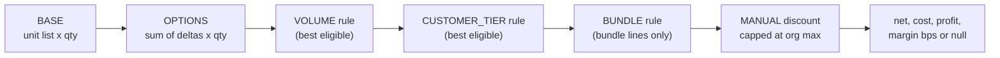
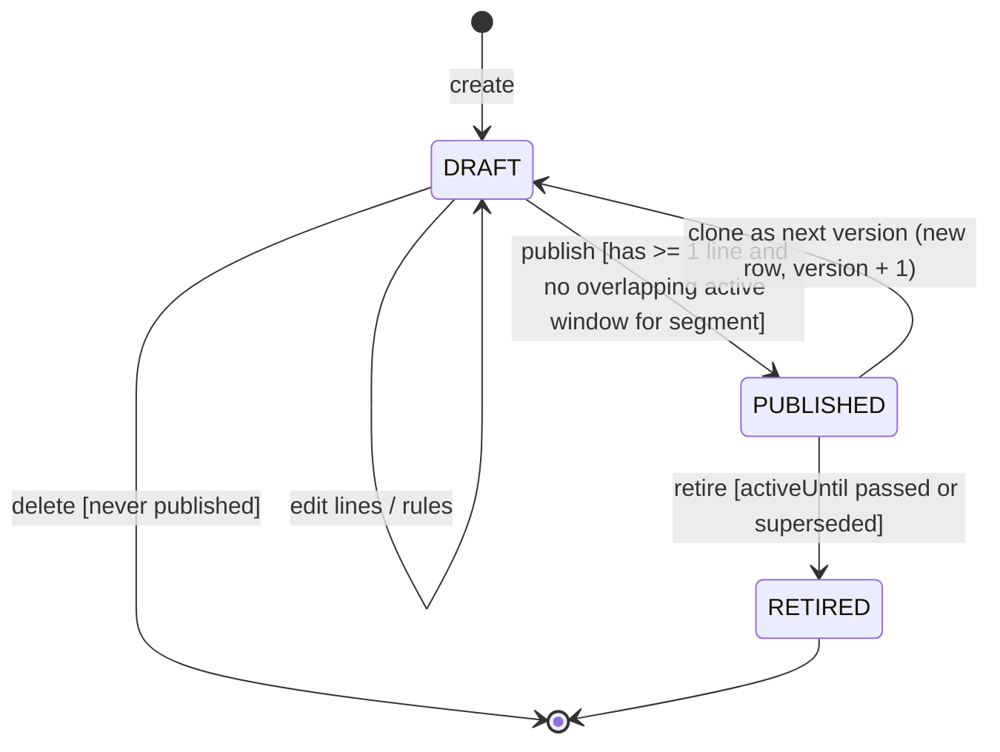
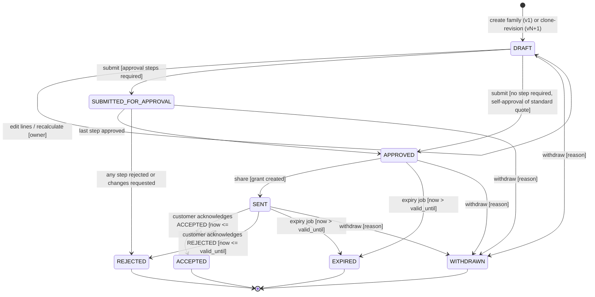
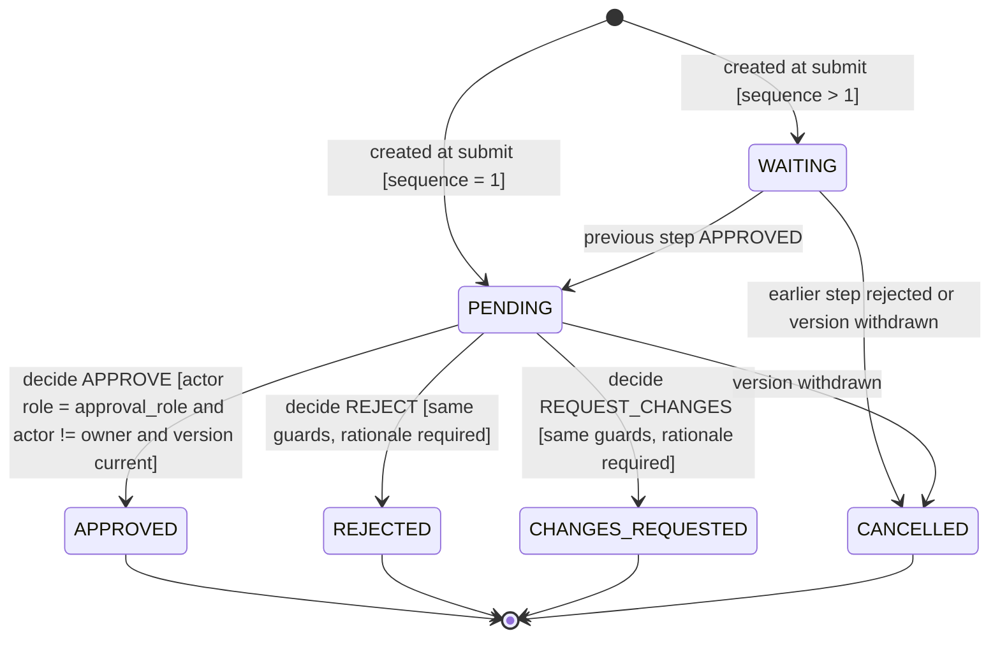

# System design

Module-by-module design of DealForge. Read with
[architecture/overview.md](../architecture/overview.md) and
[data-model.md](data-model.md). Each module lists what is **implemented** and
what is **planned**, with backlog tickets.

## 1. Design principles

1. **Server-authoritative money.** All persisted totals come from
   `priceQuote()` running in the API on database snapshots. The browser only
   previews ([ADR-0013](../adr/0013-integer-money-and-rounding-policy.md)).
2. **Immutability over updates.** Published price books, submitted quote
   versions, approval decisions, acknowledgments and audit events are never
   updated in place ([ADR-0014](../adr/0014-effective-dated-immutable-price-book-versions.md),
   [ADR-0016](../adr/0016-immutable-quote-revisions.md)).
3. **Pure domain core.** Money, pricing and approval routing are pure
   functions in `packages/shared/src/domain/` with 100 % branch coverage.
4. **Tenant scope from the session**, never from the request body
   ([ADR-0003](../adr/0003-multi-tenancy-row-level-organization-scoping.md)).
5. **One transaction per use case**, with the audit row inside it
   ([ADR-0008](../adr/0008-append-only-audit-trail.md)).

## 2. Shared domain (implemented: DF-021, DF-022, DF-023)

| File                                 | Responsibility                                                                                                               |
| ------------------------------------ | ---------------------------------------------------------------------------------------------------------------------------- |
| `domain/money.ts`                    | Safe-integer guards, overflow-checked add/subtract/multiply, `percentOfMinor`, `ratioBps`, `roundHalfAwayFromZero` on BigInt |
| `domain/money-format.ts`             | ISO 4217 minor digits, `toDecimalString`, `formatMoney`, `formatBps`, `parseDecimalToMinor` (digit-string parsing)           |
| `domain/dates.ts`                    | Strict `YYYY-MM-DD` calendar validation                                                                                      |
| `domain/pricing/types.ts`            | Immutable input/output contracts                                                                                             |
| `domain/pricing/rule-validation.ts`  | Restricted declarative rule schema (`ruleIssues`, `assertValidRule`)                                                         |
| `domain/pricing/rule-selection.ts`   | Effective-date window, condition matching, one-rule-per-category selection                                                   |
| `domain/pricing/discounts.ts`        | Percent and fixed discounts with caps; manual discount cap                                                                   |
| `domain/pricing/line-pricing.ts`     | Per-line step pipeline and snapshot figures                                                                                  |
| `domain/pricing/totals.ts`           | One-time and recurring segment totals, contract value                                                                        |
| `domain/pricing/engine.ts`           | `priceQuote()` orchestration and input checks                                                                                |
| `domain/approval/approval-policy.ts` | `evaluateApprovalPolicy()` and `approvalInputFromPricing()`                                                                  |

### 2.1 Pricing pipeline (FR-05, FR-07)

For each line, in this fixed order:



- **Eligibility:** rule category matches, `effectiveFrom <= pricingDate <=
effectiveUntil` (inclusive; `null` until is open-ended), and every present
  condition matches (product ids, product categories, min/max quantity,
  customer tiers, bundle codes). `CUSTOMER_TIER` rules need a customer tier;
  `BUNDLE` rules need a line added through a bundle.
- **Stacking:** at most one rule per category; highest `priority` wins; ties
  break on ascending rule id ([ADR-0015](../adr/0015-pricing-rule-engine-and-stacking-policy.md)).
- **Caps:** a percent rule applies `min(bps, maxDiscountBps)`; a fixed rule
  applies `min(amountPerUnit x qty, maxDiscountBps of input, input)`; the manual
  discount applies `min(requested, maxManualDiscountBps)`. Capped steps carry
  `capped: true`. No step can produce a negative amount.
- **Rounding:** each percentage stage computes `amount x bps / 10 000` exactly
  in BigInt and rounds half away from zero to the minor unit. Totals sum
  already-rounded line amounts and are never re-rounded.
- **Margin:** `grossMarginBps = round(profit x 10 000 / net)`; `null` when net
  revenue is zero, never infinity or a fabricated value.
- **Segments:** one-time and recurring lines are totalled separately;
  recurring totals are per month and add `contractValueMinor = sum(net x
billingTermMonths)`.

### 2.2 Approval routing (FR-08)

`evaluateApprovalPolicy(input, policy)` with policy
`{ managerDiscountThresholdBps, marginFloorBps }`:

| Trigger      | Condition                                             | Step                                |
| ------------ | ----------------------------------------------------- | ----------------------------------- |
| Discount     | max applied manual discount on any line `>` threshold | `SALES_MANAGER`                     |
| Margin       | any non-empty segment with margin `<` floor           | `FINANCE` (role `FINANCE_APPROVER`) |
| Zero revenue | non-empty segment with cost `> 0` and net `= 0`       | `FINANCE`                           |

Discount only yields one manager step; margin only yields one finance step;
both yield manager (sequence 1) then finance (sequence 2). Each step carries
its reasons with observed and threshold bps and a readable message
([ADR-0017](../adr/0017-approval-policy-routing.md)).

## 3. Identity, tenancy and RBAC (implemented: DF-002, DF-004)

- `users.role` holds one of six roles (CHECK in migration 0002). The shared
  `PERMISSION_MATRIX` maps 17 permissions to roles; routes call
  `requirePermission(permission)`.
- Sessions: 256-bit random token in an HTTP-only cookie, SHA-256 stored in
  `sessions`, bound to one organization. CSRF token = HMAC(session token).
- **Planned:** `sales_memberships` for several roles per tenant and
  organization selection at login (DF-008); user administration (DF-009).

## 4. Catalog module

**Implemented (DF-011, DF-012):** `GET/POST /api/v1/products`,
`GET /api/v1/products/:id`. Unique SKU per organization (constraint
`products_org_sku_key`, mapped to 409). Malformed ids return 404 rather than
422 so the response does not distinguish "invalid" from "someone else's".

**Planned:** edit and archive (DF-013), filters (DF-014), CSV import with
preview (DF-015), options (DF-016), configuration validator (DF-017), bundles
(DF-019, one nesting level).

```mermaid
sequenceDiagram
  autonumber
  actor PM as Pricing Manager
  participant API as catalog routes
  participant SVC as products.service
  participant DB as PostgreSQL
  PM->>API: POST /api/v1/products {sku, listPriceMinor, unitCostMinor, ...}
  API->>API: requirePermission(catalog:write), zod parse
  API->>SVC: create(actor, input)
  SVC->>DB: BEGIN; INSERT products; INSERT audit_events(product.created)
  alt SKU exists in this organization
    DB-->>SVC: 23505 products_org_sku_key
    SVC-->>API: 409 CONFLICT (transaction rolled back, no audit row)
  else
    SVC->>DB: COMMIT
    SVC-->>API: Product
    API-->>PM: 201
  end
```

**CSV import (DF-015)** runs in two calls: `POST /products/import?mode=preview`
parses and validates every row without writing; `mode=commit` re-parses the
same file and applies all rows in one transaction with a single audit row
carrying counts.

## 5. Pricing module (planned: DF-024 to DF-029)

### 5.1 Price-book lifecycle



A published price book and its rules are immutable. Changing prices means
cloning to a new draft version, editing, and publishing. Quotes reference the
exact `price_books.id` they were priced against
([ADR-0014](../adr/0014-effective-dated-immutable-price-book-versions.md)).

### 5.2 Simulation

`POST /api/v1/pricing/simulate` (DF-028) loads the published price book and
its rules, builds a `QuotePricingInput` with the **server date** in the
organization timezone, and returns `priceQuote()` output without persisting.

## 6. Quotes module (planned: DF-032 to DF-040)

- A **quote family** has a code (`Q-2026-000123`) and owner. Each **version**
  is an immutable record once submitted; drafts are editable only by the
  owner.
- `POST /quote-versions/:id/calculate` loads the version's price-book and rule
  snapshots and line snapshots, calls `priceQuote()`, and stores
  `calculation_snapshot_json` plus line `net_minor`/`cost_minor`. Any totals in
  the request body are ignored (D-06).

### 6.1 Quote version lifecycle



Guards are evaluated on the server with the server clock (DF-037). A rejected,
expired or withdrawn version is final; the rep continues with
`clone-revision`, which copies lines into a new DRAFT version and **never**
copies approval steps (DF-038, D-10). `reprice` creates a new version against a
newer published price book and records a before/after diff.

## 7. Approvals module (planned: DF-041, DF-042)

```mermaid
sequenceDiagram
  autonumber
  actor Rep as Sales Rep
  actor Mgr as Sales Manager
  actor Fin as Finance Approver
  participant Q as quotes.service
  participant E as priceQuote + evaluateApprovalPolicy
  participant A as approvals.service
  participant DB as PostgreSQL
  Rep->>Q: POST /quote-versions/:id/submit
  Q->>DB: BEGIN; SELECT version FOR UPDATE
  Q->>E: recalculate from snapshots, evaluate policy
  E-->>Q: steps [SALES_MANAGER, FINANCE]
  Q->>DB: UPDATE status, submitted_at; INSERT approval_steps; INSERT audit; INSERT notifications
  Q->>DB: COMMIT
  Mgr->>A: POST /approvals/:stepId/decision {APPROVE, optimisticVersion}
  A->>DB: verify step is current, actor is not owner, version is current
  A->>DB: UPDATE step, activate next; audit; notify finance
  Fin->>A: POST /approvals/:stepId/decision {REQUEST_CHANGES}
  A->>DB: step CHANGES_REQUESTED, version REJECTED; audit; notify rep
```

### 7.1 Approval step lifecycle



## 8. Proposals and customer portal (planned: DF-045 to DF-048)

- `POST /quote-versions/:id/share` requires `proposals:share`, owner, status
  `APPROVED` (else 409, D-12), and creates a `customer_quote_grants` row for a
  contact. The grant, not the id, is the access check
  ([ADR-0018](../adr/0018-customer-portal-explicit-version-grants.md)).
- Customer endpoints map to a dedicated `CustomerQuoteView` DTO built from an
  allow-list of fields; cost, margin, rule ids and internal notes are never
  selected. Missing grants return 404 (D-14).
- Acknowledgment runs in one transaction: lock version, check grant not
  revoked, check `now() <= valid_until` (else 409 with renewal instruction,
  D-15), insert acknowledgment (unique per version), set status, audit, notify.
- `GET /quote-versions/:id/print` renders print-optimized HTML from the stored
  snapshot with the organization logo (DF-059).

## 9. Reporting, notifications and audit (planned: DF-049 to DF-054)

Reports are read-only SQL over `quote_versions` and `approval_steps` with the
same organization scope. Win rate uses accepted / (accepted + rejected) and
states the denominator. "Quoted revenue" is the only revenue figure. CSV export
reuses the report query and escapes cells beginning with `=`, `+`, `-` or `@`.

## 10. Background jobs

| Job                | Schedule               | Behaviour                                                                                                              | Status      |
| ------------------ | ---------------------- | ---------------------------------------------------------------------------------------------------------------------- | ----------- |
| Session sweep      | 15 min, in API process | `DELETE FROM sessions WHERE expires_at <= now()`                                                                       | Implemented |
| Quote expiry       | 15 min                 | Expire APPROVED/SENT versions past `valid_until`; idempotent `UPDATE ... WHERE status IN (...)`; audit and notify once | DF-054      |
| Notification purge | Daily                  | Delete read notifications older than 180 days                                                                          | DF-052      |

Jobs run in a worker loop guarded by a PostgreSQL advisory lock so only one
instance executes a job at a time ([ADR-0012](../adr/0012-in-app-notifications-and-background-worker.md)).

## 11. File storage

Logos (DF-059) are stored under `UPLOAD_DIR` with random file names, validated
by magic bytes and size (`UPLOAD_MAX_BYTES`), referenced from the organization
row, and served only through an authorized route
([ADR-0011](../adr/0011-local-file-attachment-storage.md)). Proposals are HTML
printed by the browser; no PDF files are generated server-side.

## 12. Notifications

Notifications are rows in `notifications`, inserted in the same transaction as
the triggering event: approval requested (to holders of the step role),
decision recorded (to the owner), quote expired (to the owner), customer
acknowledgment (to the owner). The web polls `GET /api/v1/notifications`;
marking read is idempotent. No email is sent (PRD non-goal).

## 13. Concurrency and idempotency

| Risk                                   | Control                                                                                                                                       |
| -------------------------------------- | --------------------------------------------------------------------------------------------------------------------------------------------- |
| Duplicate SKU under concurrent creates | Unique constraint `products_org_sku_key` -> 409 (implemented)                                                                                 |
| Concurrent draft edits                 | `quote_versions.optimistic_version`; `UPDATE ... WHERE optimistic_version = $n`; 0 rows -> 409                                                |
| Double approval click or replay        | Decision request carries the step's `optimisticVersion`; identical replay returns the recorded decision (200), conflicting replay returns 409 |
| Approving an old version               | Step must belong to the family's `current_version`; else 409 (D-11)                                                                           |
| Quote-code allocation                  | Per-organization counter row locked `FOR UPDATE` inside the create transaction                                                                |
| Version numbering                      | Unique `(family_id, version_number)`                                                                                                          |
| Single acknowledgment                  | Unique `customer_acknowledgments(quote_version_id)`                                                                                           |
| Overlapping price-book windows         | Checked at publish under a per-organization advisory lock (DF-024)                                                                            |

## 14. Error handling

| Source                                                     | HTTP | Code                                                         |
| ---------------------------------------------------------- | ---- | ------------------------------------------------------------ |
| zod boundary failure, `DomainError` (pricing/money/policy) | 422  | `VALIDATION_FAILED` (`details.domainCode` for domain errors) |
| Missing session                                            | 401  | `UNAUTHENTICATED`                                            |
| Permission or CSRF failure                                 | 403  | `FORBIDDEN` / `CSRF_FAILED`                                  |
| Unknown or cross-tenant id                                 | 404  | `NOT_FOUND`                                                  |
| Uniqueness, stale version                                  | 409  | `CONFLICT`                                                   |
| Illegal state change                                       | 409  | `INVALID_STATE_TRANSITION`                                   |
| Pending endpoint                                           | 501  | `NOT_IMPLEMENTED` with `details.ticket`                      |

Unexpected errors are logged with the request id and returned as a generic 500. SQL text and stack traces never reach the client.

## 15. Performance and indexing

- Every tenant table leads its indexes with `organization_id`.
- Implemented: `products(organization_id, sku)` unique, `(organization_id,
category)`, `(organization_id, active)`.
- Planned: `quote_families(organization_id, owner_id)`,
  `quote_versions(organization_id, status, valid_until)`,
  `approval_steps(organization_id, approval_role, status)`,
  `audit_events(organization_id, occurred_at DESC)` (exists),
  `notifications(user_id, read_at)`.
- List endpoints paginate (max 100 per page). Calculation loads a version's
  lines, price-book lines for those products and rules in three queries.

## 16. Scaling path

1. Run two or more stateless API instances behind a reverse proxy; sessions
   are already in PostgreSQL.
2. Move the worker loop into its own process using the same image.
3. Add a read replica for reports and dashboards.
4. Materialize monthly report aggregates.
5. If a single tenant outgrows shared tables, partition by `organization_id`.
