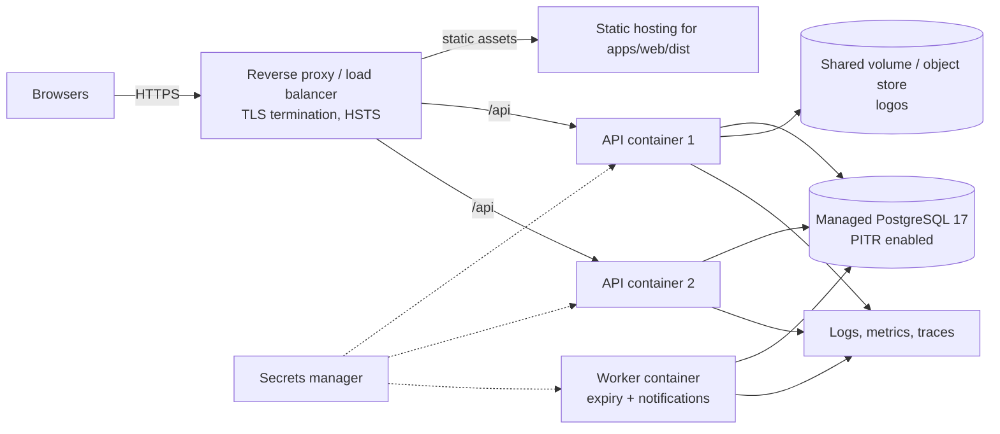

# Deployment (plan)

> **Status: plan only.** Nothing in this document is implemented yet. Packaging and the
> deployment pipeline are tracked as [DF-061](../planning/backlog.md). Today DealForge runs
> locally through `./run.sh` ([runbook.md](runbook.md)).

## Target topology

## Components

| Concern             | Plan                                                                                                                                                                                                                                                   |
| ------------------- | ------------------------------------------------------------------------------------------------------------------------------------------------------------------------------------------------------------------------------------------------------ |
| Container image     | Multi-stage build: `npm ci` + `npm run build` in a builder stage; runtime stage on a slim Node 22 image with production dependencies only, `apps/api/dist` and migrations; runs as a non-root user; read-only root filesystem except the upload volume |
| Web assets          | `apps/web/dist` served by the proxy or static hosting from the same origin as `/api`, so cookies stay first-party and `APP_ORIGIN` matches                                                                                                             |
| Reverse proxy / TLS | TLS 1.2+ with managed certificates, HSTS, HTTP to HTTPS redirect, request size limit, forwards `X-Request-Id`; `trust proxy` configured for the proxy hop                                                                                              |
| Database            | Managed PostgreSQL 17, private network only, TLS required, separate migration role (DDL) and application role (DML, no UPDATE/DELETE on `audit_events`)                                                                                                |
| Secrets             | `SESSION_SECRET` and `DATABASE_URL` from a secrets manager injected as environment variables; rotation re-issues sessions; boot fails on placeholder secret in production                                                                              |
| File storage        | Logos (DF-059) on a persistent volume or object store, never inside the image ([ADR-0011](../adr/0011-local-file-attachment-storage.md))                                                                                                               |
| Worker              | Same image, different entry point, single replica with idempotent jobs ([ADR-0012](../adr/0012-in-app-notifications-and-background-worker.md))                                                                                                         |

## Release pipeline

1. CI on the merge commit: lint, format, typecheck, unit + integration tests, build, secret scan, E2E.
2. Build and sign the image, tag with the commit SHA.
3. **Migrate**: run `node dist/db/cli.js migrate` once as a release job with the migration role.
   Migrations are forward-only and backward compatible with the previous release
   (expand, then contract in a later release) ([ADR-0004](../adr/0004-postgresql-and-forward-only-sql-migrations.md)).
4. **Deploy**: rolling update; new containers must pass `/api/health/ready` before receiving
   traffic; old containers drain on SIGTERM (the API closes the server and the pool, 10 s cap).
5. Smoke check `/api/health/ready` and a read-only API call; automatic rollback of the image on
   failure (schema stays, because migrations are backward compatible).

The seed command is never run in production (it refuses `NODE_ENV=production`).

## Observability

| Signal  | Plan                                                                                                                               |
| ------- | ---------------------------------------------------------------------------------------------------------------------------------- |
| Logs    | pino JSON to stdout, shipped to a central store; cookies, CSRF tokens and passwords redacted; request id on every line             |
| Metrics | Request rate, error rate, p95 latency per route, DB pool saturation, approval queue age, job lag                                   |
| Traces  | OpenTelemetry instrumentation for Express and pg                                                                                   |
| Alerts  | Readiness failures, 5xx rate, p95 above targets in [quality-attributes.md](../architecture/quality-attributes.md), backup failures |

## Backup and recovery

| Objective    | Target     | Mechanism                                                                                         |
| ------------ | ---------- | ------------------------------------------------------------------------------------------------- |
| RPO          | 15 minutes | Managed point-in-time recovery (continuous WAL archiving) plus nightly `pg_dump` retained 30 days |
| RTO          | 1 hour     | Restore to a new instance from PITR, repoint `DATABASE_URL`, redeploy                             |
| Verification | Monthly    | Restore drill into a staging environment and run smoke checks                                     |

Uploaded logos are backed up with the volume or object-store versioning on the same schedule.
