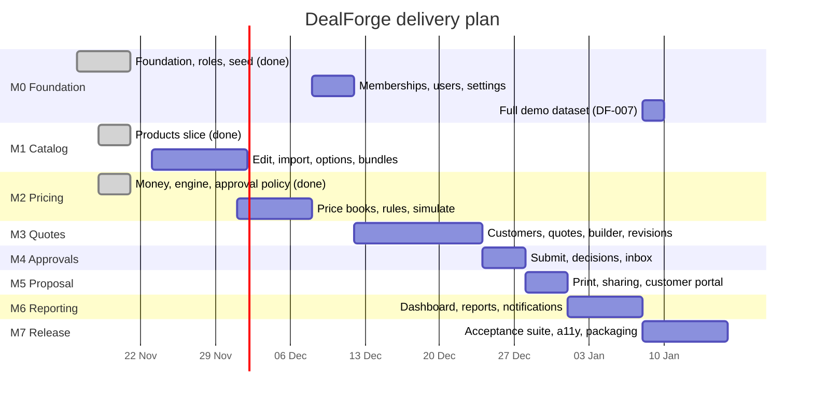

# Roadmap

DealForge is delivered in eight milestones. The backlog ([backlog.md](backlog.md),
machine-readable [backlog.json](backlog.json)) is the source of truth for tickets and
estimates; this page summarises them per milestone and sequences the remaining work.

## Current status

| Metric              |              Value |
| ------------------- | -----------------: |
| Done                |  36 h (11 tickets) |
| Pending             | 194 h (50 tickets) |
| Total               | 230 h (61 tickets) |
| Complete (by hours) |             15.7 % |

What exists today: the foundation (launcher, auth, tenancy, audit, migrations, CI), the
DealForge role model and permission matrix, the pure money / pricing-engine / approval-policy
domain in `packages/shared/src/domain/` with 100 % branch coverage, and the Products catalog
vertical slice (API + screen). Every other PRD §7 endpoint answers `501` with its ticket id and
every other PRD §4 screen renders a pending placeholder.

## Milestones

| Milestone                              | Goal                                                                                        | Exit criteria                                                                                                                                                  | Estimate (h) | Done (h) | Status                               |
| -------------------------------------- | ------------------------------------------------------------------------------------------- | -------------------------------------------------------------------------------------------------------------------------------------------------------------- | -----------: | -------: | ------------------------------------ |
| M0: Foundation                         | Running, secure, tenant-aware skeleton with the real actor model                            | `./run.sh` takes a fresh clone to a running app; auth, CSRF, audit, roles and seed in place; multi-role memberships, user admin and pricing settings delivered |           37 |       19 | In progress (DF-007..DF-010 pending) |
| M1: Catalog and configuration          | Complete product catalog incl. options, incompatibilities and bundles (FR-01, FR-03, FR-04) | Catalog CRUD, CSV import, configuration validator rejecting D-02/D-03 cases, one-level bundles                                                                 |           38 |        7 | In progress (DF-011, DF-012 done)    |
| M2: Pricing                            | Server-authoritative pricing on published, immutable price books (FR-02, FR-05, FR-07)      | Price books publishable and immutable; rules validated and stored as data; simulate endpoint returns the engine breakdown                                      |           31 |       10 | In progress (DF-021..DF-023 done)    |
| M3: Customers and quotes               | Quote families with immutable versions and server-side calculation (FR-06, FR-07)           | Reps build, calculate, revise and compare quotes; tampered totals ignored; state machine enforced on server clock                                              |           43 |        0 | Pending                              |
| M4: Approvals                          | Sequential approval workflow (FR-08)                                                        | Steps created from policy on submit; no self-approval; stale and duplicate decisions rejected                                                                  |           15 |        0 | Pending                              |
| M5: Proposal and customer portal       | Customer-safe proposals and acknowledgment (FR-09)                                          | Print view without cost/margin; explicit grants; one acknowledgment per version; expiry enforced                                                               |           15 |        0 | Pending                              |
| M6: Reporting, notifications and audit | Live dashboards, reports, notifications and audit timeline (FR-10)                          | SQL-backed dashboard and reports, filtered CSV export, notifications, expiry job, audit timeline                                                               |           24 |        0 | Pending                              |
| M7: Acceptance and release             | PRD §9 acceptance suite and release readiness                                               | D-01..D-21 green in CI, WCAG 2.1 AA audit fixed, logo upload, container image and deployment pipeline                                                          |           27 |        0 | Pending                              |

## Schedule

Assumes roughly 25 focused engineering hours per week, starting 2026-11-23. Pricing work (M2)
overlaps the end of M1 because the engine is already built; the full demo dataset (DF-007)
lands after customers, quotes and approvals exist.

## Sequencing principles

1. Financial correctness first: money, pricing and approval routing are pure, tested modules
   before any quote persistence ([ADR-0013](../adr/0013-integer-money-and-rounding-policy.md),
   [ADR-0015](../adr/0015-pricing-rule-engine-and-stacking-policy.md),
   [ADR-0017](../adr/0017-approval-policy-routing.md)).
2. Immutability before workflow: price-book versions and quote revisions are immutable before
   approvals depend on them ([ADR-0014](../adr/0014-effective-dated-immutable-price-book-versions.md),
   [ADR-0016](../adr/0016-immutable-quote-revisions.md)).
3. Customer surfaces last, behind explicit grants and redacted DTOs
   ([ADR-0018](../adr/0018-customer-portal-explicit-version-grants.md)).
4. If the schedule slips, simplify bundle options and reporting, never pricing correctness,
   version isolation or approval integrity (PRD §10).
