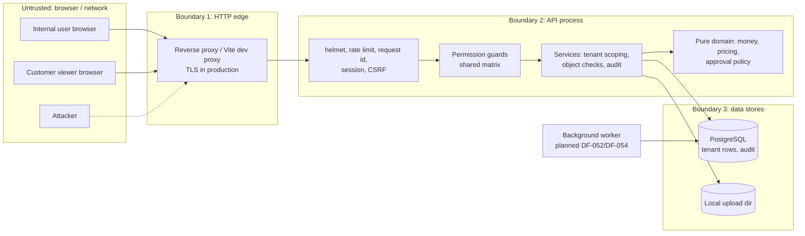

# Threat model

Scope: the DealForge MVP as built in this repository (API, web SPA, PostgreSQL, local file
storage) plus the planned workflow modules. Method: asset and actor inventory, trust
boundaries, STRIDE per component, mitigations with status. Status values: **implemented**
(in code and covered by tests) or **pending** (with the delivering ticket).

## Assets

| Asset                                         | Why it matters                                                                        | Classification                   |
| --------------------------------------------- | ------------------------------------------------------------------------------------- | -------------------------------- |
| Internal costs, gross margin, discount policy | Competitive and commercial secret; leaking it to a customer weakens every negotiation | Confidential                     |
| Pricing rules and price-book versions         | Determine every quoted price; tampering changes revenue silently                      | Confidential, integrity-critical |
| Quote versions and line snapshots             | Legal and commercial record of what was offered and accepted                          | Integrity-critical               |
| Approval steps and decisions                  | Evidence that exceptions were authorised by the right person                          | Integrity-critical               |
| Customer quote grants and acknowledgments     | Control what a customer sees and record their decision                                | Confidential, integrity-critical |
| Sessions and password hashes                  | Account takeover gives the victim's role                                              | Secret                           |
| Audit trail                                   | Reconstructs who changed prices, rules, revisions, approvals and sharing              | Integrity-critical, append-only  |
| Uploaded logos (planned)                      | Rendered on proposals; a vector for stored XSS if mishandled                          | Internal                         |

## Actors

| Actor                    | Trust                  | Goals / abuse cases                                                                |
| ------------------------ | ---------------------- | ---------------------------------------------------------------------------------- |
| Sales Organization Admin | High within own tenant | Misconfigure thresholds; must not reach other tenants                              |
| Pricing Manager          | High within own tenant | Edit prices and rules; must not self-approve own quote exceptions                  |
| Sales Representative     | Medium                 | Push larger discounts, understate totals, bypass approval, read other reps' drafts |
| Sales Manager            | Medium-high            | Approve within limits; must not bypass finance on margin-critical quotes           |
| Finance Approver         | Medium-high            | Approve low-margin exceptions; must not change lines while approving               |
| Customer Viewer          | Low                    | Read costs/margin, read other customers' quotes, accept expired quotes             |
| Curious customer         | Low                    | Enumerate quote ids, inspect API JSON and print markup for internal fields         |
| Malicious tenant         | Low                    | Read or modify another organization's data by guessing ids                         |
| External attacker        | None                   | Credential stuffing, CSRF, XSS, injection, session theft                           |

## Trust boundaries

Every request crosses boundary 1 and 2; organization id and role always come from the
server-side session (boundary 2), never from the request body.

## STRIDE analysis

| Component         | Threat (STRIDE)               | Scenario                                           | Mitigation                                                                                                                                              | Status                                                                 |
| ----------------- | ----------------------------- | -------------------------------------------------- | ------------------------------------------------------------------------------------------------------------------------------------------------------- | ---------------------------------------------------------------------- |
| Web SPA           | Spoofing                      | UI hides a screen but the API still serves it      | Authorization only in API; nav uses the same matrix for display only ([ADR-0007](../adr/0007-role-based-access-control.md))                             | implemented                                                            |
| Web SPA           | Tampering (D-06)              | Rep edits client JSON to understate totals         | Client totals never accepted; server recalculates with `priceQuote` from snapshots                                                                      | domain implemented (`pricing-engine.test.ts`); endpoint pending DF-035 |
| Web SPA           | Information disclosure        | XSS steals data                                    | React escaping, strict CSP via helmet, no `dangerouslySetInnerHTML`                                                                                     | implemented                                                            |
| API               | Spoofing                      | Credential stuffing                                | scrypt hashes, generic 401, dummy-hash timing equalisation, 10 logins/min/IP                                                                            | implemented                                                            |
| API               | Tampering                     | Mass assignment / unexpected fields                | zod `.strict()` schemas at the boundary; 422 envelope                                                                                                   | implemented (products)                                                 |
| API               | Repudiation                   | User denies changing a price                       | Audit row in the same transaction as the change ([ADR-0008](../adr/0008-append-only-audit-trail.md))                                                    | implemented (products); pending per module                             |
| API               | Denial of service             | Request floods, huge bodies                        | Global rate limit, 1 MB JSON limit, pagination max 100                                                                                                  | implemented                                                            |
| API               | Elevation of privilege        | Rep calls catalog or approval endpoints            | `requirePermission` on every route incl. pending ones (403 before 501)                                                                                  | implemented (`pending-routes.http.test.ts`, `products.db.test.ts`)     |
| Session / CSRF    | Spoofing                      | Session fixation or theft                          | 256-bit random token, only SHA-256 stored, HttpOnly SameSite=Lax cookie, Secure in production                                                           | implemented                                                            |
| Session / CSRF    | Tampering                     | Cross-site form posts                              | Origin check + HMAC `X-CSRF-Token` bound to the session ([ADR-0005](../adr/0005-session-authentication-scrypt-and-csrf.md))                             | implemented                                                            |
| Pricing engine    | Tampering                     | Arbitrary code in rules                            | Restricted declarative schema validated by `ruleIssues`; no expression evaluation ([ADR-0015](../adr/0015-pricing-rule-engine-and-stacking-policy.md))  | implemented (domain); API pending DF-026                               |
| Pricing engine    | Tampering                     | Float rounding or overflow manipulates totals      | Integer minor units, BigInt intermediates, safe-integer guards ([ADR-0013](../adr/0013-integer-money-and-rounding-policy.md))                           | implemented                                                            |
| Pricing engine    | Tampering                     | Discount stacking beyond policy                    | One rule per category, per-rule caps, manual cap, floor at zero                                                                                         | implemented                                                            |
| Pricing engine    | Tampering                     | Silent retroactive repricing                       | Quotes lock to a published price-book version; reprice creates a new version ([ADR-0014](../adr/0014-effective-dated-immutable-price-book-versions.md)) | pending DF-024, DF-038                                                 |
| Approval workflow | Elevation of privilege (D-09) | Quote owner approves own exception                 | Service rejects decisions where `decided_by = owner_id`                                                                                                 | pending DF-042                                                         |
| Approval workflow | Tampering (D-11)              | Approval of old version applied to new revision    | Steps bound to version id; optimistic locking; new versions start with no approvals ([ADR-0016](../adr/0016-immutable-quote-revisions.md))              | pending DF-042                                                         |
| Approval workflow | Elevation of privilege        | Manager bypasses finance                           | Sequential steps from `evaluateApprovalPolicy` ([ADR-0017](../adr/0017-approval-policy-routing.md))                                                     | domain implemented; workflow pending DF-041                            |
| Approval workflow | Repudiation                   | Approver denies a decision                         | Decision row + audit row with rationale in one transaction                                                                                              | pending DF-042                                                         |
| Customer portal   | Information disclosure (D-13) | Customer reads cost, margin or internal notes      | Dedicated redacted DTO; customer has no `catalog:read`/`quotes:read`                                                                                    | permission implemented; DTO pending DF-047                             |
| Customer portal   | Information disclosure (D-14) | Customer guesses another quote id                  | Access requires an active `customer_quote_grants` row; otherwise 404 ([ADR-0018](../adr/0018-customer-portal-explicit-version-grants.md))               | pending DF-047                                                         |
| Customer portal   | Tampering (D-15/D-16)         | Accept an expired or already-decided version       | Server-clock expiry; unique acknowledgment per version                                                                                                  | pending DF-047                                                         |
| Database          | Information disclosure (D-19) | Tenant B reads tenant A rows                       | Every query filters `organization_id` from the session; 404 on foreign ids ([ADR-0003](../adr/0003-multi-tenancy-row-level-organization-scoping.md))    | implemented for products                                               |
| Database          | Tampering                     | Invalid money or roles written directly            | CHECK constraints on role, SKU, money bounds; unique `(organization_id, sku)`                                                                           | implemented                                                            |
| Database          | Repudiation                   | Audit rows altered                                 | Append-only by convention; production role without UPDATE/DELETE on `audit_events`                                                                      | convention implemented; grants pending DF-061                          |
| File storage      | Tampering / XSS               | Malicious SVG or oversized logo                    | Type allow-list, size limit, random names outside web root ([ADR-0011](../adr/0011-local-file-attachment-storage.md))                                   | pending DF-059                                                         |
| Background worker | Denial of service / tampering | Expiry job runs twice or with client time          | Idempotent job on server clock; transitions audited ([ADR-0012](../adr/0012-in-app-notifications-and-background-worker.md))                             | pending DF-054                                                         |
| Reports export    | Tampering                     | CSV formula injection when opened in a spreadsheet | Prefix cells starting with `= + - @` and tabs with `'`                                                                                                  | pending DF-051                                                         |

## OWASP ASVS L2 highlights

| ASVS area                     | Control in DealForge                                                                             | Status                                                                               |
| ----------------------------- | ------------------------------------------------------------------------------------------------ | ------------------------------------------------------------------------------------ |
| V2 Authentication             | scrypt (N=32768), min 12-char passwords, generic errors, login rate limit                        | implemented                                                                          |
| V3 Session management         | Opaque server sessions, hashed at rest, TTL, logout invalidates, HttpOnly/SameSite/Secure        | implemented                                                                          |
| V4 Access control             | Deny by default, permission matrix, tenant scoping, object-level checks (own drafts, grants)     | partial: matrix and tenant scoping implemented; object checks pending DF-032, DF-047 |
| V5 Validation                 | zod schemas at every boundary; parameterised SQL only                                            | implemented                                                                          |
| V7 Error handling and logging | Stable error envelope without stack traces; pino with redaction of cookies, CSRF and passwords   | implemented                                                                          |
| V8 Data protection            | Cost/margin never in customer DTOs; no secrets in repo                                           | pending DF-047 for customer DTOs                                                     |
| V11 Business logic            | Server-side calculation, approval gates, state machine, idempotent decisions                     | domain implemented; workflow pending DF-037, DF-041, DF-042                          |
| V12 Files                     | Upload type/size limits, storage outside web root                                                | pending DF-059                                                                       |
| V14 Configuration             | Validated env at boot, placeholder secret rejected in production, helmet headers, gitleaks in CI | implemented                                                                          |

## Tenant-isolation test plan

| Layer                         | Test                                                                                                                                                   | Status                      |
| ----------------------------- | ------------------------------------------------------------------------------------------------------------------------------------------------------ | --------------------------- |
| Integration (real PostgreSQL) | `apps/api/test/products.db.test.ts`: Corvid admin gets 404 for a Helix product id and never sees Helix SKUs in lists; same SKU allowed in both tenants | implemented                 |
| Integration                   | Same pattern for every new repository: price books, rules, customers, quotes, approvals, grants                                                        | pending (per module ticket) |
| HTTP                          | `pending-routes.http.test.ts`: every pending route requires authentication and enforces its permission                                                 | implemented                 |
| E2E                           | D-19 "Org B accesses Org A quote": cross-tenant access denied via UI and direct API                                                                    | pending DF-058              |
| E2E                           | D-14 customer cannot read another customer's quote even via direct API                                                                                 | pending DF-057              |

Rules for new code: organization id comes from `req.auth.user`, never from input; a foreign id
returns 404 (not 403) to avoid confirming existence; every repository gets a cross-tenant test.
