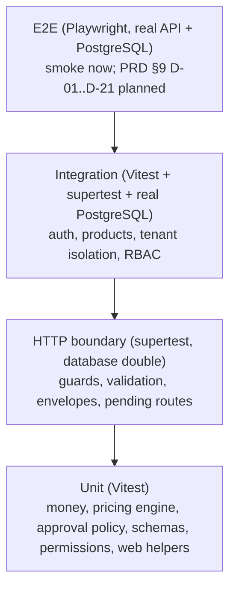

# Test strategy

DealForge is treated as a financial-calculation system: pricing arithmetic, approval gates,
role access and tenant isolation are proven by automated tests before UI polish
([ADR-0010](../adr/0010-testing-strategy.md)).

## Test pyramid

The bulk of the confidence sits in pure unit tests of `packages/shared/src/domain/`, because
that code decides every price. Integration tests prove the SQL layer (tenant scoping,
constraints, audit in the same transaction). E2E tests prove the browser flows against real data.

## Tools

| Layer       | Tooling                         | Notes                                                                                           |
| ----------- | ------------------------------- | ----------------------------------------------------------------------------------------------- |
| Unit        | Vitest 2, v8 coverage           | `packages/shared`, `apps/api`, `apps/web` (jsdom + Testing Library)                             |
| HTTP        | supertest against `createApp()` | Database double (`apps/api/test/fake-session.ts`) answers the session lookup with a chosen role |
| Integration | supertest + real PostgreSQL 17  | `TEST_DATABASE_URL`; schema dropped, migrated and seeded per file (`apps/api/test/db-setup.ts`) |
| E2E         | Playwright (Chromium)           | Reuses a running dev server locally, starts one in CI                                           |

API test files run sequentially (`fileParallelism: false` in `apps/api/vitest.config.ts`)
because database suites rebuild one shared schema.

## Coverage gates

| Scope                                                      | Gate                                         | Enforced by                                                  |
| ---------------------------------------------------------- | -------------------------------------------- | ------------------------------------------------------------ |
| `packages/shared/src/domain/**` (money, pricing, approval) | 100 % lines, branches, functions, statements | `packages/shared/vitest.config.ts` thresholds                |
| Each workspace overall                                     | ≥ 80 %                                       | Vitest thresholds / CI review; `npm run test:coverage` in CI |
| New code                                                   | Tests first (red, green, refactor)           | [CONTRIBUTING.md](../../CONTRIBUTING.md)                     |

## Existing test files

| File                                                  | Covers                                                                                                                                     |
| ----------------------------------------------------- | ------------------------------------------------------------------------------------------------------------------------------------------ |
| `packages/shared/test/domain/money.test.ts`           | Integer guards, overflow, half-away-from-zero rounding boundaries, `percentOfMinor`, `ratioBps` null on zero denominator                   |
| `packages/shared/test/domain/money-format.test.ts`    | Currency digits, decimal strings, `formatMoney`, `formatBps`, `parseDecimalToMinor`                                                        |
| `packages/shared/test/domain/dates.test.ts`           | Calendar-valid ISO dates                                                                                                                   |
| `packages/shared/test/domain/rule-selection.test.ts`  | Inclusive effective windows, conditions, one rule per category, priority and id tie-break                                                  |
| `packages/shared/test/domain/rule-validation.test.ts` | Restricted declarative rule schema                                                                                                         |
| `packages/shared/test/domain/pricing-engine.test.ts`  | Golden scenario, step order, caps, fixed discounts, bundles, zero revenue, billing terms, invalid input                                    |
| `packages/shared/test/domain/approval-policy.test.ts` | Manager / finance routing, thresholds at the boundary, zero-revenue cost, golden scenario                                                  |
| `packages/shared/test/schemas.test.ts`                | Login and pagination schemas, roles                                                                                                        |
| `packages/shared/test/permissions.test.ts`            | Permission matrix (PRD §3)                                                                                                                 |
| `packages/shared/test/products.schema.test.ts`        | Product create contract: integer money, SKU normalisation, strictness                                                                      |
| `apps/api/test/app.http.test.ts`                      | Health, headers, 404 envelope, auth required, CSRF origin, validation                                                                      |
| `apps/api/test/pending-routes.http.test.ts`           | Sample of pending routes return 501 + ticket; permissions enforced before 501; every pending route requires auth                           |
| `apps/api/test/products.http.test.ts`                 | Products boundary: malformed id 404, fractional money 422, pagination bounds, customer 403                                                 |
| `apps/api/test/products.db.test.ts`                   | Products slice on PostgreSQL: pagination, create + audit, 409 duplicate SKU, 403 rep, 403 customer, 404 cross-tenant, CSRF, DB money CHECK |
| `apps/api/test/integration.db.test.ts`                | Migrations/seed idempotent, role CHECK, login/CSRF/logout, generic login failure                                                           |
| `apps/api/test/lib.test.ts`                           | SQL helpers, domain error mapping to 422                                                                                                   |
| `apps/api/test/auth.service.test.ts`                  | Login, timing-safe failures, logout                                                                                                        |
| `apps/api/test/env.test.ts`                           | Environment validation                                                                                                                     |
| `apps/api/test/password.test.ts`, `tokens.test.ts`    | scrypt hashing, session and CSRF tokens                                                                                                    |
| `apps/api/test/not-implemented.test.ts`               | `pendingRouter` contract                                                                                                                   |
| `apps/web/test/client.test.ts`                        | Envelope unwrap, page metadata, CSRF header                                                                                                |
| `apps/web/test/navigation.test.ts`                    | Every PRD §4 screen present once, tickets, role visibility                                                                                 |
| `apps/web/test/product-form.test.ts`                  | Decimal text to minor units, field errors                                                                                                  |
| `apps/web/test/ProductTable.test.tsx`                 | Money and margin display, empty state                                                                                                      |
| `apps/web/test/PendingPage.test.tsx`                  | Placeholder names screen and ticket                                                                                                        |
| `e2e/tests/smoke.spec.ts`                             | Login redirect, bad credentials, rep read-only catalog, pricing manager creates product, pending screen shows ticket                       |

## PRD §9 unit-test requirements

| Requirement            | Where                                                                             | Status         |
| ---------------------- | --------------------------------------------------------------------------------- | -------------- |
| Rounding boundaries    | `money.test.ts`, `pricing-engine.test.ts`                                         | ✅ implemented |
| Zero-revenue margin    | `money.test.ts` (`ratioBps`), `pricing-engine.test.ts`, `approval-policy.test.ts` | ✅ implemented |
| Discount stacking      | `pricing-engine.test.ts` (stacking and caps)                                      | ✅ implemented |
| Billing terms          | `pricing-engine.test.ts` (term validation, contract value)                        | ✅ implemented |
| Rule precedence        | `rule-selection.test.ts`                                                          | ✅ implemented |
| Configuration rules    | planned `packages/shared/test/domain/configuration.test.ts`                       | ⏳ DF-017      |
| State transition gates | planned `apps/api/test/quote-state.test.ts`                                       | ⏳ DF-037      |

## PRD §9 acceptance matrix

All acceptance specs run in a real browser against the real API and PostgreSQL with seeded
data (DF-007); no mocked API responses.

| Test ID | Scenario                                                 | Planned spec                                            | Ticket | Status     |
| ------- | -------------------------------------------------------- | ------------------------------------------------------- | ------ | ---------- |
| D-01    | Rep creates customer quote                               | `e2e/tests/acceptance/d01-create-quote.spec.ts`         | DF-055 | ⏳ Pending |
| D-02    | Required option missing rejected                         | `e2e/tests/acceptance/d02-required-option.spec.ts`      | DF-055 | ⏳ Pending |
| D-03    | Incompatible options rejected                            | `e2e/tests/acceptance/d03-incompatible-options.spec.ts` | DF-055 | ⏳ Pending |
| D-04    | Bundle quantities and component prices                   | `e2e/tests/acceptance/d04-bundle-quantities.spec.ts`    | DF-055 | ⏳ Pending |
| D-05    | Volume/customer/manual discounts match integer reference | `e2e/tests/acceptance/d05-discount-stacking.spec.ts`    | DF-056 | ⏳ Pending |
| D-06    | Tampered client totals ignored                           | `e2e/tests/acceptance/d06-tampered-totals.spec.ts`      | DF-056 | ⏳ Pending |
| D-07    | Manual discount above threshold needs approval           | `e2e/tests/acceptance/d07-discount-approval.spec.ts`    | DF-056 | ⏳ Pending |
| D-08    | Margin below floor needs finance                         | `e2e/tests/acceptance/d08-margin-finance.spec.ts`       | DF-056 | ⏳ Pending |
| D-09    | Owner self-approval denied                               | `e2e/tests/acceptance/d09-self-approval.spec.ts`        | DF-056 | ⏳ Pending |
| D-10    | Reject v1, clone to v2                                   | `e2e/tests/acceptance/d10-revision.spec.ts`             | DF-056 | ⏳ Pending |
| D-11    | Stale version approval rejected                          | `e2e/tests/acceptance/d11-stale-approval.spec.ts`       | DF-056 | ⏳ Pending |
| D-12    | Share unapproved quote denied                            | `e2e/tests/acceptance/d12-share-unapproved.spec.ts`     | DF-057 | ⏳ Pending |
| D-13    | Customer proposal hides cost and margin                  | `e2e/tests/acceptance/d13-customer-redaction.spec.ts`   | DF-057 | ⏳ Pending |
| D-14    | Customer cannot read another customer's quote            | `e2e/tests/acceptance/d14-cross-customer.spec.ts`       | DF-057 | ⏳ Pending |
| D-15    | Expired quote acceptance rejected                        | `e2e/tests/acceptance/d15-expired-acceptance.spec.ts`   | DF-057 | ⏳ Pending |
| D-16    | Acceptance recorded once                                 | `e2e/tests/acceptance/d16-acceptance.spec.ts`           | DF-057 | ⏳ Pending |
| D-17    | Archived product keeps quote snapshot                    | `e2e/tests/acceptance/d17-archived-snapshot.spec.ts`    | DF-058 | ⏳ Pending |
| D-18    | Print view, separate totals                              | `e2e/tests/acceptance/d18-print.spec.ts`                | DF-058 | ⏳ Pending |
| D-19    | Org B cannot access Org A quote                          | `e2e/tests/acceptance/d19-tenant-isolation.spec.ts`     | DF-058 | ⏳ Pending |
| D-20    | Data persists across reload and restart                  | `e2e/tests/acceptance/d20-persistence.spec.ts`          | DF-058 | ⏳ Pending |
| D-21    | Report date filter and export                            | `e2e/tests/acceptance/d21-reports.spec.ts`              | DF-058 | ⏳ Pending |

## Test data strategy

- **Unit**: in-code fixtures (`packages/shared/test/domain/pricing-fixtures.ts`) reproduce the
  PRD §8 golden scenario with hand-computed integer expectations.
- **Integration**: each database file calls `freshDatabase()` which drops the schema, runs all
  migrations and the development seed, giving a known baseline (Helix Managed Services and
  Corvid Industrial Supply, one user per role, sample products).
- **E2E**: runs against the development database seeded by `./run.sh`; specs create uniquely
  named records (for example `E2E-<timestamp>` SKUs) so reruns do not collide. The full PRD §8
  dataset arrives with DF-007.
- No production or real customer data is ever used in tests.

## Running the tests

| Goal                                                                | Command                                                                                |
| ------------------------------------------------------------------- | -------------------------------------------------------------------------------------- |
| Unit + integration (creates `<db>_test`, e.g. `dealforge_dev_test`) | `./run.sh test`                                                                        |
| Everything CI runs (lint, format, typecheck, tests)                 | `./run.sh check`                                                                       |
| E2E (prepares DB, launches app if needed)                           | `./run.sh e2e` or `npm run test:e2e` with the app running                              |
| Coverage                                                            | `TEST_DATABASE_URL=postgres://localhost:5432/dealforge_dev_test npm run test:coverage` |
| One workspace                                                       | `npm test -w @dealforge/shared` (or `@dealforge/api`, `@dealforge/web`)                |

Integration suites are skipped when `TEST_DATABASE_URL` is unset; `run.sh test` always sets it.
Note that the login endpoint is rate limited to 10 attempts per minute per IP in development,
so repeated E2E runs in quick succession may need a short pause.
